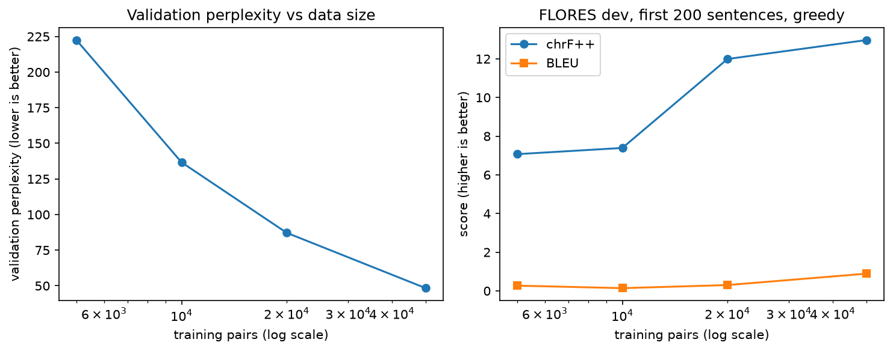
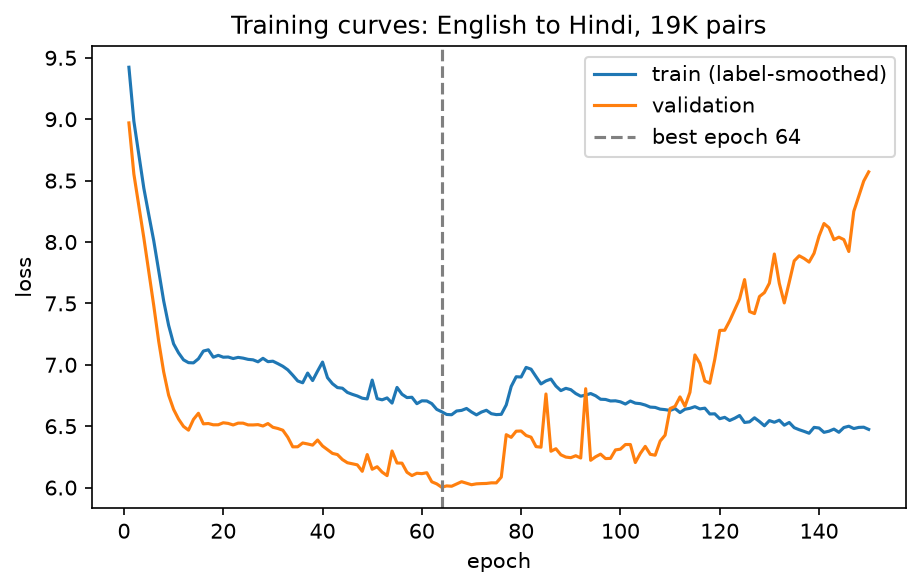

# Indic Transformer MT

English to Hindi translation with a Transformer implemented from scratch in PyTorch, following "Attention Is All You Need" (Vaswani et al., 2017). The project studies how translation quality changes with the amount of training data.

## What is implemented from scratch
- Scaled dot-product attention, multi-head attention, padding and causal masks
- Sinusoidal positional encoding, position-wise feed-forward network, encoder and decoder stacks
- Shared embedding and output weights, with embeddings scaled by sqrt(d_model)
- Training: Adam with the paper's warmup schedule, label smoothing, token-budget batching, early stopping
- Greedy and beam search decoding
- 23 unit tests (masks, parameter counts, causality, padding, beam search equals greedy at beam 1)

PyTorch layers such as `nn.Linear`, `nn.LayerNorm` and `nn.Embedding` are used. SentencePiece, SacreBLEU and Hugging Face `datasets` handle tokenization, scoring and data loading.

## Model
| Setting | Paper (base) | This project |
|---|---|---|
| Layers | 6 | 3 |
| d_model | 512 | 256 |
| Heads | 8 | 4 |
| Feed-forward size | 2048 | 1024 |
| Dropout | 0.1 | 0.3 |
| Warmup steps | 4000 | 800 |
| Vocabulary | about 37K shared BPE | 8K shared BPE |

The model has 7,577,600 parameters.

## Data-efficiency experiment
The same model was trained on 5K, 10K, 20K and 50K sentence pairs from the IITB English-Hindi corpus. Smaller sets are prefixes of larger ones, so each size contains the previous one. Model size, tokenizer, schedule and validation set were held fixed. Each run used up to 30 epochs with early stopping, and scoring used greedy decoding on the first 200 sentences of the FLORES-200 `dev` split.

| Training pairs | Best val perplexity | chrF++ | BLEU |
|---|---|---|---|
| 5,000 | 222.5 | 7.07 | 0.27 |
| 10,000 | 136.7 | 7.39 | 0.14 |
| 20,000 | 87.2 | 11.99 | 0.30 |
| 50,000 | 48.3 | 12.97 | 0.89 |



### What the results show
- Validation perplexity falls steadily with more data: about 4.6 times lower at 50K than at 5K.
- chrF++ rises from about 7 to 13.
- BLEU stays below 1 at every size. On 200 sentences at this score level it is mostly noise, so I do not read a trend into it.
- Even at 50K pairs the model's translations are fluent-looking Hindi that often loops or drifts away from the source sentence. A from-scratch model needs far more data than this.

### Limitations
- Every run ended at the 30-epoch cap (best epoch 28 to 30), so the larger runs were probably still improving.
- Data size and number of optimizer steps changed together, so the curve mixes both effects.
- One run per size, with no repeated seeds. Dropout was fixed at 0.3, which suits small data better than large.
- BLEU and chrF++ come from 200 sentences with greedy decoding.
- The tokenizer was trained on only 20K pairs.
- The 100K and 200K sizes were not run.
- The FLORES `devtest` split has not been used.

## Pilot baseline
A first run on about 18K cleaned pairs (before the experiment above) reached a best validation loss of 4.56 (perplexity about 96). On the first 100 FLORES dev sentences with greedy decoding it scored BLEU 0.46 and chrF++ 10.36. The experiment's tokenizer and data split differ from the pilot's, so the two are not directly comparable.



## Reproduce
```bash
uv sync
uv run pytest -v

# data and tokenizer for the experiment
uv run python prepare_flores.py
uv run python make_subsets.py

# train and score one size (GPU recommended)
uv run python train.py --data data/train200k --spm data/spm_exp.model --size 50000 --tag n50000 --epochs 30 --patience 4
uv run python evaluate.py --spm data/spm_exp.model --ckpt checkpoints/n50000.pt --tag n50000 --beam 1 --n 200
```
Training on a CPU is far too slow (one epoch on 5K pairs took about 20 minutes), so I trained on a free Kaggle T4 GPU. A checkpoint only works with the exact `spm.model` it was trained with.

## Repository layout
- `model/`: attention, layers, encoder, decoder, Transformer, masks, decoding
- `training/`: dataset batching and the learning-rate schedule
- `tests/`: unit tests
- `results/exp/`: results of the data-efficiency experiment
- `docs/`: figures

## License and data
Code is MIT licensed (see `LICENSE`). Datasets are not stored in this repository. They keep their own terms: the IITB English-Hindi corpus is for non-commercial research use (Kunchukuttan et al., LREC 2018), and FLORES-200 is from the NLLB Team. Check each dataset's page for its license before reuse.

## References
- Vaswani et al., "Attention Is All You Need", NeurIPS 2017
- Kunchukuttan et al., "The IIT Bombay English-Hindi Parallel Corpus", LREC 2018
- NLLB Team, "No Language Left Behind" (FLORES-200)
